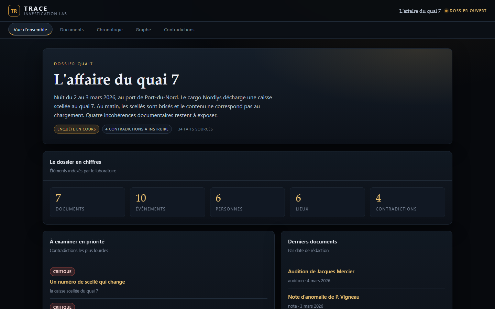
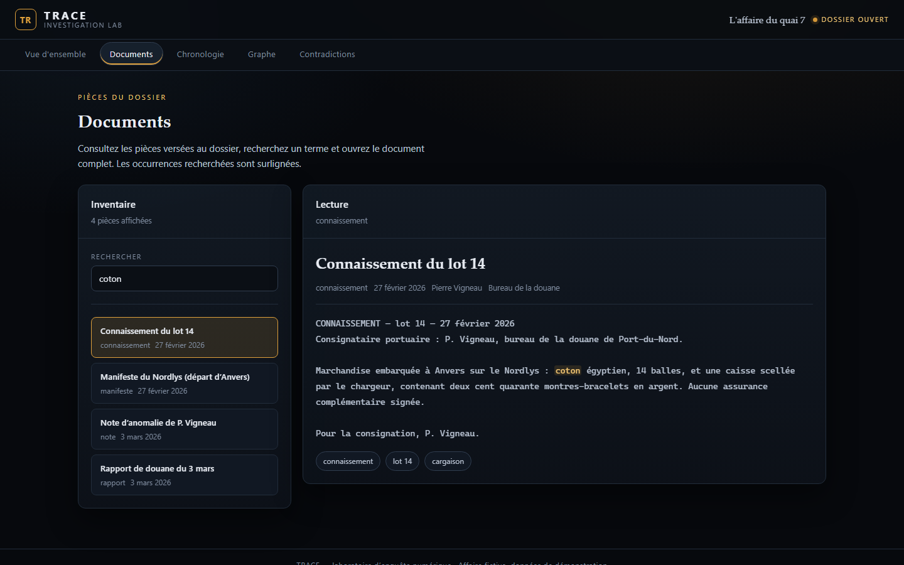
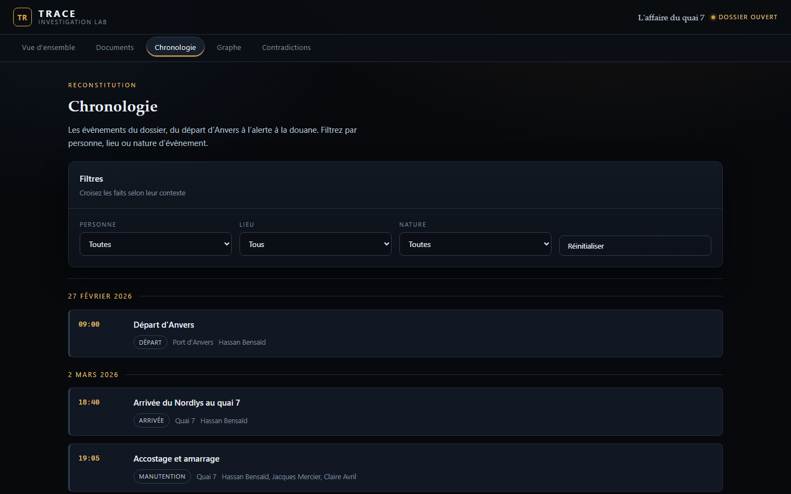
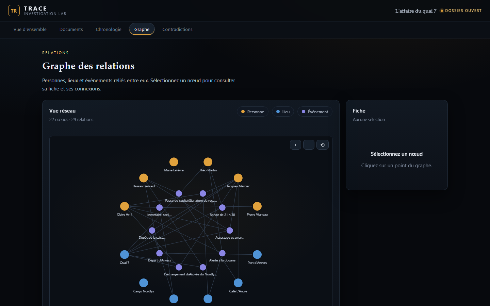
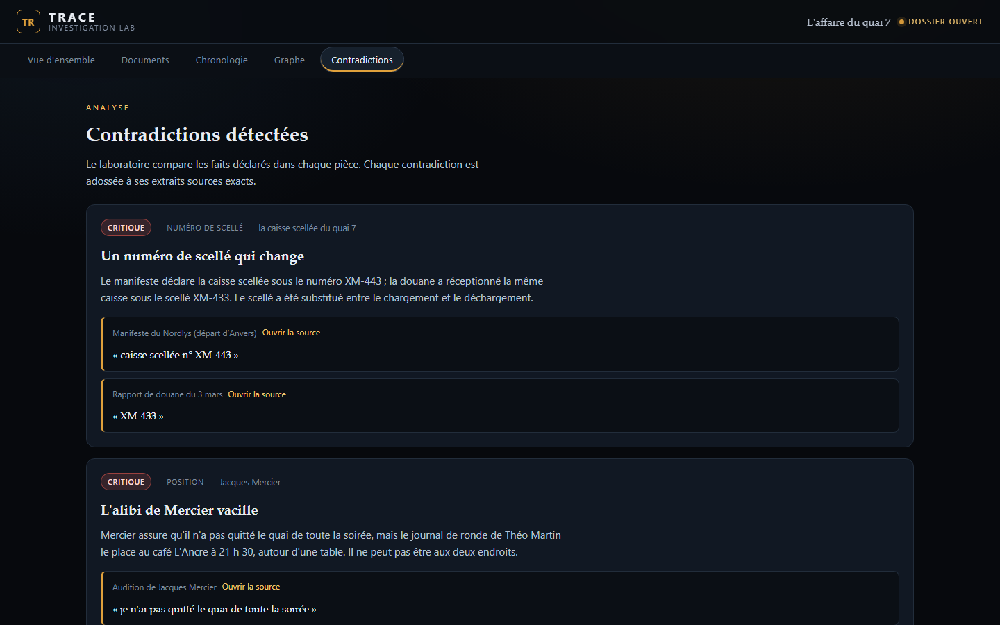
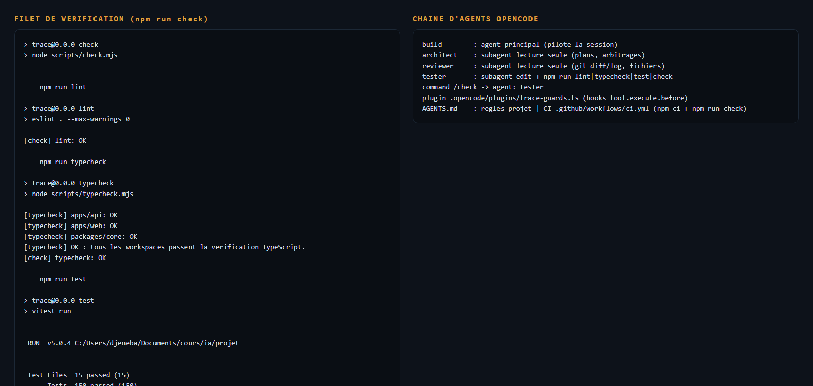

# TRACE — The Digital Investigation Lab

TRACE est une application d'enquête numérique autour d'une affaire fictive,
**« L'affaire du quai 7 »**. À partir de pièces versées au dossier (connaissement,
rapports, notes, photographies…), elle permet de **rechercher** l'information,
**reconstituer la chronologie**, **visualiser le graphe des relations** et surtout
**détecter des contradictions** entre les déclarations, chacune adossée à ses
**extraits sources exacts**.

Le projet est un monorepo npm (workspaces) : un front React + Vite, une API
Node.js + TypeScript, et un package `@trace/core` de logique partagée (types,
recherche, chronologie, graphe, détecteur de contradictions). Aucune API d'IA
payante n'est utilisée : la détection est déterministe et testée.

## Fonctionnalités

- **Vue d'ensemble** — chiffres du dossier, contradictions prioritaires, derniers documents.
- **Documents** — recherche (accents et ligatures gérés), surlignage des occurrences, lecture
  complète d'une pièce et mise en évidence de l'extrait cité.
- **Chronologie** — filtres croisés personne / lieu / nature, cartes dépliables (clavier inclus).
- **Graphe des relations** — personnes, lieux et évènements reliés, zoom / déplacement / sélection,
  fiche détaillée et connexions ; nœuds accessibles au clavier.
- **Contradictions** — tri par gravité, explication, et pour chaque fait un lien direct vers
  l'extrait exact dans le document source.

## Captures d'écran

Réalisées avec un vrai navigateur (Edge headless) sur l'application lancée, API en marche :











Le filet de vérification et la chaîne d'agents (`npm run check`) :



Le reste des captures est dans [`docs/screenshots/`](docs/screenshots/).

## Prérequis

- **Node.js ≥ 22.12** (testé avec Node 24) et **npm ≥ 10** (testé avec npm 11).
- PowerShell sous Windows : préfixer par `npm.cmd` (les shims `.ps1` peuvent être bloqués).

## Installation

Depuis la racine du dépôt :

```bash
npm ci
```

(`npm install` fonctionne aussi ; `npm ci` garantit une installation reproductible
depuis `package-lock.json`.)

## Lancer l'application

Deux terminaux, depuis la racine :

```bash
# Terminal 1 — API (http://localhost:3000)
npm run dev -w @trace/api

# Terminal 2 — interface web (http://localhost:5173)
npm run dev -w @trace/web
```

Ouvrir ensuite <http://localhost:5173>. Le web interroge l'API sur
`http://localhost:3000` par défaut ; pour changer, définir `VITE_API_URL`.

Pour servir le build de production :

```bash
npm run build -w @trace/web
npm run preview -w @trace/web
```

## Vérifications

Depuis la racine (sans changer de répertoire) :

```bash
npm run lint       # ESLint (flat config, --max-warnings 0)
npm run typecheck  # TypeScript strict sur les 3 workspaces
npm run test       # Vitest
npm run check      # lint + typecheck + test (échoue si l'un échoue)
npx prettier --check .   # format
```

Sur Windows PowerShell : `npm.cmd run check`.

## Structure du dépôt

```
apps/
  api/        API HTTP Node.js + TypeScript (routeur maison, CORS, erreurs JSON)
  web/        Interface React + Vite (routes par hash, graphe SVG maison)
packages/
  core/       Logique partagée : types, données, recherche, chronologie, graphe,
              détecteur de contradictions (source de vérité côté serveur)
scripts/      check.mjs, typecheck.mjs (orchestration des contrôles)
.opencode/    Harness OpenCode : agents, commande, plugin (hooks)
.github/      CI GitHub Actions (npm ci + npm run check)
docs/         sujet-tp3.pdf (lecture seule) + screenshots/ + demo.md
```

## Harness OpenCode

Le travail est piloté avec la chaîne d'agents OpenCode :

- **`AGENTS.md`** — règles du projet (périmètre, interdits, commandes, conventions).
- **Agents** (`.opencode/agents/`) :
  - `architect` — lecture seule : plans et arbitrages, sans modifier de fichier.
  - `reviewer` — lecture seule : relit le code et les diffs (`git diff/log/show`), signale les écarts.
  - `tester` — peut éditer et lancer `npm run lint|typecheck|test|check`.
- **Commande** `.opencode/commands/check.md` — `/check` : exécute `npm run check` et analyse le résultat.
- **Plugin / hook** `.opencode/plugins/trace-guards.ts` — branche le hook `tool.execute.before`
  d'OpenCode pour interdire la lecture des `.env` et toute modification de `docs/sujet-tp3.pdf`.
- **CI** `.github/workflows/ci.yml` — `npm ci` puis `npm run check` sur Node 24.

### Ce qui n'est volontairement pas configuré

- **MCP** : aucun serveur MCP n'est branché. Le projet n'a besoin d'aucun service externe
  (pas de base de données, pas d'API tierce) ; ajouter un MCP décoratif n'apporterait rien.
- **Skills** : aucune skill projet dédiée ; `AGENTS.md` et la commande `/check` couvrent les
  besoins.
- Le plugin utilise le hook officiel `tool.execute.before` (doc OpenCode). Il est chargé au
  **démarrage** d'OpenCode : un redémarrage est nécessaire pour le prendre en compte.

## Limites connues

- La détection de contradictions est **déterministe et limitée à l'affaire fournie** ; ce n'est
  pas un moteur d'IA généraliste.
- Le lien vers un extrait source présuppose que l'extrait est la **première occurrence** du texte
  dans le document (vrai avec le détecteur actuel).
- Les tests d'interaction se font en **SSR (`renderToString`) et en logique pure** ; il n'y a pas
  de tests DOM (pas de jsdom/testing-library) pour ne pas alourdir le projet. La vérification
  navigateur se fait via Edge headless (voir `docs/screenshots/`).
- Le graphe SVG est accessible au clavier (nœuds `role="button"`, `Enter`/`Espace`) mais reste
  une visualisation sommaire.

## Démonstration

Un scénario de démonstration orale de 2–3 minutes est fourni dans
[`docs/demo.md`](docs/demo.md).
